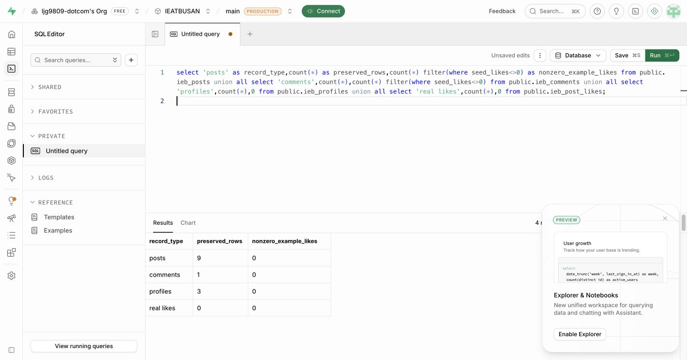
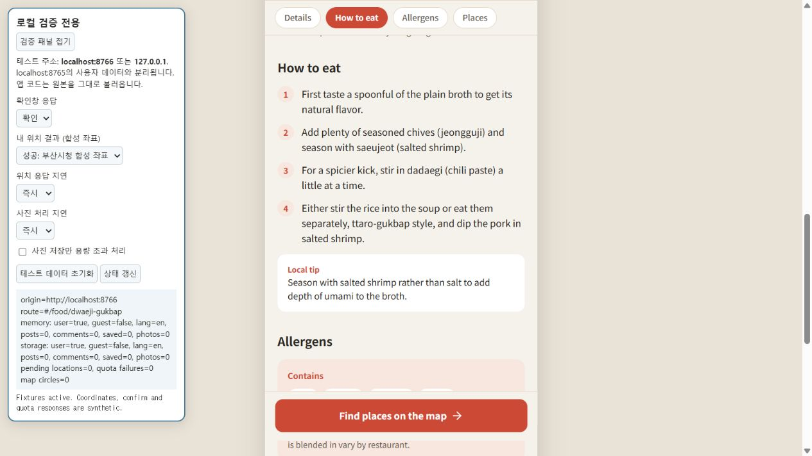
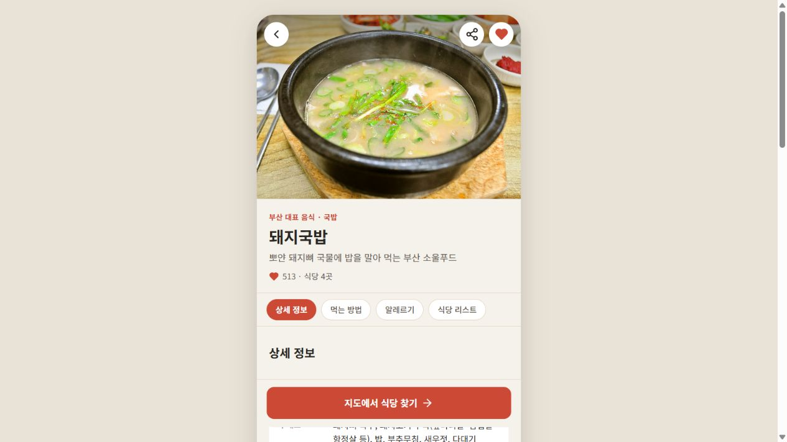
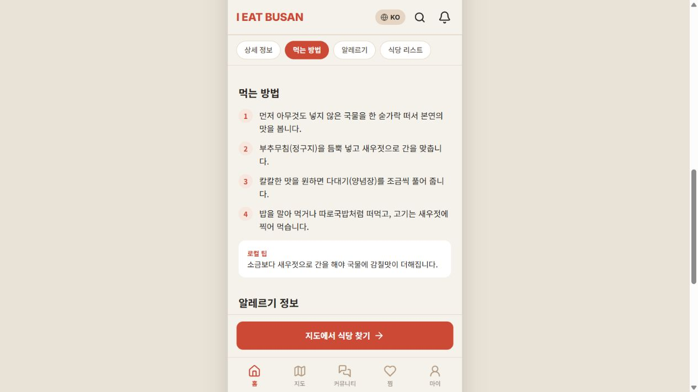

## 2026-11-05 식당 주소 기반 Google 미니지도

- main 6fd3487 pull 후 fix/restaurant-map-fallback에서 로컬 수정. 기존 국가/좋아요/DB 카탈로그 통합 유지.
- 좌표 없는 상세 화면도 미니지도 컨트롤러를 연결. Google Geocoding으로 주소 조회 후 표시하며 원본/DB에는 좌표를 기록하지 않음.
- 부분 주소 일치/지역 수준의 대략 좌표는 거절. 세션 내 주소 결과 재사용, 10초 제한, 화면 이탈 후 응답 무시 및 실패 시 Google 검색 링크 유지.
- 전체 23개 검사/빌드 통과. 실제 목구멍 하단점 화면은 로컬 키 미설정으로 지도 타일/실제 주소 조회 미검증. 키 설정 안내/Google 검색 링크와 콘솔 오류 없음을 확인.
- 실제 사용 전 Maps JavaScript API와 Geocoding API 활성화/키 제한 확인 필요. SQL·Supabase 데이터 변경 및 commit/push 없음.

## 2026-11-05 country-snapshots PR 제출 전 검증

- 최신 origin/main 591604d와 기준 일치. 국가 미선택(NULL/빈 문자열/공백)의 KR 기본값을 API에서 검증.
- 회원/댓글 SQL 구조, 회원 API/UI, 인증, 공개 진입, 좋아요, Google/구역 지도, 원고, 비동기 사진, 홈, 빌드/배포 등 21개 스크립트 통과.
- SQL은 실제 DB 미실행. DB 소유자가 적용 후 실계정 댓글 작성/국가 변경과 RLS를 확인해야 함. 자동 병합하지 않음.
- 기존 archive 시안 삭제는 이번 기능 커밋에서 제외.

## 2026-11-05 최신 Google Maps 연동과 두 로컬 수정 통합

- main 591604d를 --ff-only --autostash로 pull. index/app/i18n 충돌을 해결하고 변경은 미커밋 상태로 복원.
- Google 지도 공급자/로더와 네이버 직접 링크 유지. Google→네이버→카카오 순서·명칭 복원.
- 작성 국가 배지, 새 댓글 국가 저장, 국가 변경의 프로필 이동과 기존 댓글 무백필 SQL 유지.
- 실제 DB 변경/원격 push 없음. 아래 이전 기준 dfd5c16은 최초 구현 당시 기록.

## 2026-11-05 작성 국가 고정·프로필 국가 변경 (로컬)

- 최신 main dfd5c16 pull 후 feature/country-snapshots에서 작업. 기존 계정/글/댓글 데이터 수정 없음.
- 글·댓글은 저장된 작성 국가로 표시. 새 댓글 국가 저장, 이전 댓글 NULL 유지/배지 숨김.
- 프로필에서 활동 지역 대신 국가 변경, 설정 국가 메뉴 제거. 기존 area 값 보존.
- 프로필 저장 버튼을 하단 메뉴 위에 고정해 가림 방지. 전체 20개 검사·빌드 통과.
- 합성 데이터 브라우저에서 프로필 KR→JP 저장, JP 글·댓글 작성, 프로필 US 저장 후에도 두 배지 JP 유지 확인.
  프로필 선택 US/활동 지역 컨트롤 없음, 콘솔 경고·오류 없음. profile-country-preview.png, country-snapshot-preview.png 참고.
- 추가 SQL은 미실행이며 실제 DB의 댓글 국가 저장/권한은 적용 후 검증 필요. commit/push 없음.

## 2026-11-05 PR 충돌 해결 및 DB 좋아요 0 반영

- PR #3: 최신 main의 공통 음식 상세/주소/영업시간/휴무 구현 보존. 45종 공통 화면과 100개 원고 식당 자료 검사 통과.
- PR #5: 국가 기능을 최신 지도·상세 화면과 통합. 음식·식당·게시글·댓글의 좋아요 0을 화면에 표시.
- Supabase 운영 DB: 사용자 지정 조직의 IEATBUSAN에서 예시 좋아요 0 및 기본값 0 적용. 기존 국가 컬럼/트리거 적용 상태 확인.
- 프로필 3개·글 9개·댓글 1개·실제 좋아요 0개 변경 전후 동일. 실제 좋아요 레코드와 사용자 콘텐츠 삭제 없음.
- 빌드 및 18개 자동 검사 통과. API 회귀에는 seed_likes=99 입력이 실제 사용자 좋아요를 부풀리지 않는지 검증 추가.
- 운영 실제 계정 신규 가입/국가 변경과 RLS 쓰기 검사는 별도. PR 미리보기 API는 배포 접근 보호로 직접 검증하지 못함.

# 검증 기록

## 2026-11-05 회원 국가 기능 브랜치 푸시 전 확인

- feature/member-country에서 신규 국가/메인 진입/SQL 구조와 기존 지도·원고·사진·홈·인증·API·빌드·배포까지 18개 스크립트 통과.
- origin/main 기준 dd5c5bf와 작업 기준 일치. DB 실제 실행·실제 계정 검증·main 병합은 대기.
- 이전 시안 archive 파일 4개의 로컬 삭제는 기능 커밋 대상에서 제외.

## 2026-11-05 제공된 Supabase 구조 엑셀 대조

- 조사자료의 IEATBUSAN_Supabase_테이블구조_20261105.xlsx 6개 시트를 읽기 전용으로 확인.
- 6개 앱 테이블/32개 컬럼 이름·순서와 17개 RLS 정책 이름을 schema.sql과 대조해 일치 확인.
- 회원/게시글 국가 컬럼은 없으며 기존 컬럼 권한에 국가 수정/삽입 허용을 추가해야 함.
  준비한 마이그레이션의 테이블·관계·정책 가정과 충돌 없음.
- 가입 함수 본문은 엑셀에 미포함이므로 기존 함수를 교체하지 않고 별도 프로필 삽입 트리거에서 국가 저장하도록 SQL 보완.
  SQL 구조 검사 통과(가입 함수/기존 Auth 트리거/RLS 유지, 국가 허용값/컬럼 권한). 실제 SQL 실행·DB 계정 검증은 대기.
- 원본 엑셀/실제 DB/운영 배포/원격 Git은 변경하지 않음. docs/member-country.md에 확인 셀과 남은 절차 기록.

## 2026-11-05 메인 우선 진입과 상단 로그인

- 첫 방문/비로그인 상태에서도 홈·음식·지도·커뮤니티 열람. 우측 상단 로그인 링크 추가.
- 회원 전용 경로는 로그인으로 이동. 언어 선택 확인 후 홈/기존 화면 복귀.
- public-entry 검사 추가. 국가 기능을 포함한 전체 17개 검사·빌드 통과.
- 합성 데이터 브라우저에서 루트→홈, 상단 로그인→로그인 폼, 로고→홈, 언어 변경 후 복귀 확인.
  기본 430px 화면에서 가로 넘침 없음, 콘솔 경고/오류 없음. home-login-preview.png 참고.
- DB 적용·commit/push·운영 배포는 진행하지 않음.

## 2026-11-05 회원 국가 기능 로컬 검사 (DB 구조 확인 대기)

- feature/member-country에서 가입 국가명/기본 KR, 코드 배지, 개인정보 국가 변경,
  같은 국가 글 우선, 게스트 활동 메뉴 숨김 및 직접 접근 제한 구현.
- 국가 UI/서버 검사 2개와 기존 지도·원고·사진·홈·인증·API·빌드·배포까지 16개 스크립트 통과.
- 테스트 데이터 전용 8781 서버에서 대한민국 기본 선택/249옵션, JP 가입→로그인,
  US로 국가 변경→US 글 우선 표시, 로그아웃→게스트 마이페이지 활동 메뉴 없음 확인.
  브라우저 경고/오류 로그 없음. 화면 증거 member-country-preview.png는 합성 데이터입니다.
- 실제 Supabase 구조/SQL 실행/기존 계정 KR 반영/실제 재로그인 검증은 아직 하지 않았습니다.
  supabase/migrations/20261105_member_country.sql은 구조 확인 후 검토·적용할 초안입니다.
- commit/push/운영 배포/실제 DB 변경 없음. 이전 archive 4개 파일 이동에 따른 삭제는 별도 작업입니다.

## 2026-11-05 최신 main과 지도 브랜치 통합

- 기준 main `703899d`, 지도 작업 복구 커밋 `1161d90`. max-branch 미병합 변경 미포함.
- 원고 식당 상세 정보/사진 대체 경로와 지도 모듈을 연결. 원본 음식 데이터는 main과 동일하게 유지.
- 새 식당은 명시적 districtId 우선, 없으면 원본 research.area/address의 부산 구·군 연결.
  좌표 미확인 100항목은 목록 유지/핀 제외, 행 클릭 시 상세 이동.
- 지도 검사 7개, 음식 원고·사진·홈·인증·API 검사, 빌드·배포까지 14개 스크립트 통과.
- 브라우저: 최초 SVG 16구역/Leaflet 요청 0개, 복국 상세 핀/목록 3개·타일 정상,
  수영구 변경 시 목록 9개/좌표 안내, 두보완당 행→팀원 상세 원고→부산 완당 4개 섹션 연결 확인.
  금수복국 미니 지도/핀 1개 확인. 콘솔 경고/오류 없음.
- 화면 증거: map-main-integration.png (수영구와 최신 식당 목록 연결).
- 로컬 DB 미설정 상태의 게스트 검사이며 실제 Supabase/운영 배포/새 지도 API 검증은 아님.

## 2026-11-04 지도 코드 전체 정리

- 고정 지역/식당 연결, 데이터 변환, 주소 검증, HTML 렌더링, SDK 로더, 공급자와 화면 수명을 분리.
- 지도 검사 6개(contracts/loader/lifecycle/districts/regressions/provider), 사진·홈·인증·API 검사,
  정적 빌드·배포 검사까지 총 12개 스크립트 통과.
- 실제 브라우저의 첫 구역 화면: 16개 지역, Leaflet JS/CSS 요청 0개.
  해운대구→복국 상세: 핀/목록 3개, SDK JS/CSS 각 1개 및 타일 이미지 로드 확인.
- 지역 드롭다운 수영구 변경→식당 상세: 미니 지도/핀 각 1개, SDK 중복 없음.
  뒤로가기→구역 지도 복귀 시 수영구 선택과 음식 목록 유지, 타일 0개 확인.
- 잘못된 지역 주소는 404/복귀 링크를 표시하고 지도 생성 0개. 브라우저 경고·오류 로그 없음.
- `map-cleanup-verified.png`는 정리 후 수영구 선택 화면입니다.
- 실제 운영 Supabase 연결/새 공급자 API 검증은 포함하지 않음. 로컬 DB 설정 안내는 기존 상태.
  foods.js의 음식·식당 원본과 backend/Store/Cloud/Supabase 스키마는 미변경.
- 로컬 전용 작업이며 commit/push하지 않음. 이전 상태와 정리 후 상태는 저장소 밖 백업에 보관.

## 2026-11-04 상세 지도 지역 드롭다운

- 상세 지도 우측 상단에 부산 전체+16개 구·군 선택 추가. 지역 변경 시 기존 음식 선택은 초기화하고
  새 지역의 모든 등록 식당을 표시. 선택 상태는 주소에 반영하며 구역 지도 복귀에도 사용.
- 4개 언어, 17개 옵션/선택 상태, 올바른 주소 이동, 잘못된 값 차단, 화면 이탈 시 이벤트 제거 검사 통과.
- 지도 검사 3개 및 빌드·배포 검사 통과. 실제 브라우저에서 수영구(핀/목록 1개)→부산 전체(핀 69개)→
  해운대구(13곳) 전환 확인. commit/push 없음. 화면: `map-region-picker.png`.

## 2026-11-04 상세 지도 상단 전환 버튼

- `구역 지도`: 선택 지역을 유지한 SVG 구역 지도로 복귀.
- `부산 전체 지도`: 지역·음식 필터를 해제한 `#/map/detail`로 직접 이동. 4개 언어 적용.
- 구역/데이터·SDK 검사 3개 및 빌드·배포 검사 통과.
- 로컬 브라우저에서 수영구 상세(1곳)→부산 전체(핀/목록 69개) 확인.
  브라우저 뒤로가기로 수영구 상세 복귀→구역 지도 클릭 시 수영구 선택 유지/타일 0개 확인.
- 로컬 전용, commit/push 없음. 화면 증거: `map-navigation.png`.

## 2026-11-04 구역 지도 로컬 임시 시안

- 첫 지도는 로컬 SVG로 부산 16개 구·군 경계/이름만 표시하며 상세 지도 SDK를 초기화하지 않음.
- `node tests/map-districts.cjs`: 16개 경계, 지역별/음식별 필터, 4개 언어,
  빈 지역, 상세/복귀 주소, 기존 foodId:index 및 기존 음식 지도 주소 유지 통과.
- 지도 회귀·SDK 경계·사진·캐러셀·인증·API·빌드·배포 검사까지 총 9개 스크립트 통과.
- 로컬 브라우저: 해운대구 선택→음식 6종/식당 13곳→복국 선택→상세 지도 핀 3개/목록 3개→
  구역 지도 복귀 후 해운대구 선택 유지/타일 이미지 0개 확인. 북구 선택 시 음식/식당 0개 및 빈 목록 안내 확인.
- 구·군 이름이 뒤에 그리는 경계에 가리지 않도록 도형/이름 레이어 분리. 좁은 구역은 연결선 사용.
- 경계는 KOSTAT 2013 단순화 자료에서 부산만 추출한 과거 경계 미리보기. 좌표 정확도/최신 경계 검증은 아님.
- 새 지도 API와 운영 DB 검증은 포함하지 않음. 로컬의 DB 미설정 안내는 기존 상태이며 게스트로 확인.
- 사용자 요청에 따라 commit/push하지 않음. [임시 구역 지도 화면](district-preview.png).

## 2026-11-04 지도 모듈 분리

- `feature/map-renewal`에서 지도 데이터·화면·SDK·스타일 분리. 인증·서버·DB 코드는 변경하지 않음.
- `node tests/map-regressions.cjs`: 기존 69개 항목, 식당 상세/찜 식별자, 4개 언어, 음식 필터,
  목록과 핀 연결, 미니 지도, 지도 교체·위치 응답 순서·오류·정리, SDK 미지원 안내 통과.
- `node tests/map-provider.cjs`: 핀 이동, 이전 팝업 타이머 취소, 제거 후 팝업 차단,
  위치 원 1개 유지, 중복 dispose 통과. SDK 경계는 모의 객체 사용.
- 기존 위치 검사는 새 모듈 검사로 이전. `node tests/async-regressions.cjs`는 사진 처리 2/2 통과.
- `node tests/home-carousel.cjs`, `node tests/auth-regressions.cjs`, `node tests/api-regressions.cjs`,
  `node tools/build-static.cjs`, `node tests/deployment.cjs` 통과.
- 실제 로컬 개발 서버 `http://127.0.0.1:8779`에서 게스트 진입, 전체 지도 69개 핀,
  밀면 필터 4개 핀·목록, 목록 선택→원조 개금밀면 팝업→식당 상세→미니 지도 핀 1개→지도 복귀 확인.
  확인한 타일은 로드 완료, 지도 CSS 별도 로딩 확인, 수집된 warn/error 로그 없음.
- 로컬 Supabase 환경변수 미설정으로 최초 데이터 로드 시 설정 안내가 표시됨. 게스트 지도만 확인했으며
  실제 계정·DB 연결과 네이티브 위치 권한은 이번 브라우저 확인에 포함하지 않음.
- 새 공급자 API 키 연결과 구역 SVG 지도 화면은 아직 미구현. 키 관리 절차는 `map-development.md` 참고.
- 확인 화면: [지도 모듈 분리 후 핀과 식당 연결](map-module-verified.png).

## 2026-11-03 Supabase 연결 코드

- Vercel Node API `/api/service` 추가. 서버에서만 SUPABASE_URL/PUBLISHABLE_KEY/SECRET_KEY 사용, 공개 프론트엔드에는 비밀 키·세션 토큰 미포함.
- Supabase Auth 가입/로그인, 서버 검증 세션, HttpOnly/SameSite 쿠키와 토큰 갱신, CSRF 검사, 가입 요청 제한 연결. 사용자 입력의 user_id 대신 서버에서 검증한 사용자 ID 사용.
- 공개 게시글·댓글·좋아요와 계정별 프로필·찜·최근 검색·설정, 비공개 Storage 사진 저장 연결. 이전 로컬 시안 데이터는 삭제하지 않으며 신규 계정으로 재가입 필요.
- 빌드·배포 파일 검사, API 모의 응답 회귀, 프론트 인증 상태 회귀, 자동 스와이프 회귀, 기존 비동기 회귀 7/7 통과.
- Supabase 테이블/RLS 확인 및 기존 예시 게시글·댓글 초기 데이터 등록 완료. Security Advisor 오류·경고 없음. 가입 제한 테이블의 RLS 정책 없음 정보 알림은 일반 사용자 접근을 전면 차단하는 의도된 서버 전용 구성임. 참고: https://supabase.com/docs/guides/database/database-linter?lint=0008_rls_enabled_no_policy
- 실제 HTTP 연결 검사 명령은 자동 승인 검토 서비스의 일시적인 용량 오류로 실행되지 않음. 업로드 후 `/api/service?action=status` 및 실제 계정/게시글 저장 검증은 별도 결과로 갱신할 것.

## 2026-11-03 Vercel 배포 설정

- Framework `Other`, 설치 명령 없음, build `node tools/build-static.cjs`, output `dist`를 `vercel.json`으로 지정.
- 빌드 시 프로덕션 HTML의 로컬 참조 파일 존재와 JS 문법을 검증하고, index.html/css/js/assets만 배포 폴더에 복사.
- `node tools/build-static.cjs`, `node tests/deployment.cjs` 통과: 설정값, 배포 파일 구성, 모든 음식 사진과 JS/CSS 포함 확인.
- 기존 자동 스와이프, 로그인/회원가입, 비동기 회귀 검사 모두 통과.
- GitHub push까지 수행하는 요청이며, Vercel 계정에서 저장소 연결·실제 공개 배포 성공 여부는 이번 로컬 검사만으로 확인되지 않음.
- 현재 계정·게시글은 브라우저 저장 방식이며, Supabase 인증 함수 배포가 자동 승인 검토에서 거부되어 DB 연결은 미완료. 이 정적 배포에는 미완성 DB 연결 코드를 포함하지 않음.

## 2026-11-03 홈 자동 넘김

- 미조작 4초 후 다음 음식 이동, 마지막에서 첫 음식 반복. 터치 중 정지하고 pointerup/cancel 후 4초 재대기. 버튼·방향키·스크롤도 대기시간 재설정.
- 자동 넘김 멈춤/재생 지원, 백그라운드 탭에서는 정지하며 탭 복귀 후 재대기. 홈 이탈 시 타이머 및 이벤트 제거.
- `tests/home-carousel.cjs` 가상 시계로 3,999ms 미이동/4,000ms 이동, 반복, 터치 정지·재시작, 직접 이동 후 시간 재설정, pause/resume, 탭 숨김·복귀, cleanup 검증 통과. 로그인 회귀 및 기존 비동기 회귀 7/7 통과.
- 실제 휴대전화 손가락 터치는 미검증. 사용자 요청에 따라 커밋·push 없이 로컬 수정 상태로 유지.

## 2026-11-03 아이디·비밀번호 로그인 / 회원가입

- 회원가입·로그인 모두 아이디와 비밀번호 두 입력칸. 기존 소셜 시작 버튼 제거, 회원가입 링크 추가, 비밀번호 확인·이메일·전화번호 입력 없음. 4개 언어 안내 적용.
- 비밀번호는 무작위 salt와 PBKDF2-SHA-256 검증값으로만 저장. 서버 인증이 없는 브라우저 로컬 시안이라는 범위를 화면과 README에 명시.
- `node tests/auth-regressions.cjs`: 가입 입력 검증, 중복 ID(대소문자 포함), salt/검증값 차이, 비밀번호 평문 미저장, 오입력 거부, 계정별 저장·프로필 복원, 저장 실패 롤백, 계정 탈퇴 분리, crypto 미지원 처리 통과.
- 미리보기 브라우저에서 가입 → 로그인 화면 → 잘못된 비밀번호 오류 → 정상 로그인 → 마이페이지 → 로그아웃 → 중복 아이디 가입 오류 흐름 확인. 콘솔 오류 없음.
- 홈 캐러셀 검사 및 기존 비동기 회귀 검사 7/7 통과. 실제 서버 인증·다른 기기 간 계정 공유는 미구현.
- 사용자가 수정 후 대기를 요청하여 커밋·push·배포하지 않음.

## 2026-11-03 새 clone에 홈 스와이프 복구

- 기존 고정 상·하단 메뉴를 유지하며 추천 음식 5개 캐러셀 추가. 브라우저 기본 가로 스크롤과 CSS scroll-snap 사용, 하단 음식 목록 20개 유지.
- `node --check js/app.js`, `node --check js/i18n.js`, `node tests/async-regressions.cjs` (7/7), `node tests/home-carousel.cjs` 통과.
- 새 회귀 검사는 4개 언어 × 2개 정렬, 5개 슬라이드·20개 목록 카드, 이동 버튼·페이지·방향키·스크롤 상태 동기화, 재렌더 위치 복원, 리사이즈, 이벤트 해제 검증.
- 브라우저 실제 viewport 폭 390px에서 5개 슬라이드와 20개 목록, 다음/페이지 버튼, 정렬 후 마지막 슬라이드 유지 확인. 목록 아래 스크롤 후에도 헤더 top=0과 하단 메뉴 고정 유지, 콘솔 오류 없음.
- 실제 휴대전화의 손가락 터치는 미검증. 이번 작업의 실행·화면 확인은 로컬 미리보기 환경에서 진행.

검증일: 2026-11-03 / 로컬: http://localhost:8765

## 결과

| 항목 | 결과 |
|---|---|
| KO/EN/ZH/JA 각 28개 화면 렌더 | 112개 통과, 빈 화면·빈 탭 제목·언어 불일치 0건 |
| 지도 → 음식 필터 → 홈 반복 | 총 30회 전환, 수정 후 콘솔 오류 0건 |
| 게스트 커뮤니티 글쓰기 | 수정 전 홈으로 잘못 이동; 수정 후 로그인 화면 표시 |
| 지도 목록 상세 보기 | 수정 전 이동 차단; 수정 후 식당 상세로 이동, Enter 키도 확인 |
| 사진 게시글·댓글 | 사진 1장 첨부 및 등록, 댓글 등록, 새로고침 후 사진과 댓글 유지 |
| 프로필 | 닉네임·지역·소개 저장 후 새로고침으로 유지 확인 |
| 찜 | 홈 하트 선택 후 찜 목록에 반영 |
| 설정 | 알림 토글 유지, 영어 변경 후 설정 화면 복귀 |
| 게시글 삭제 | 테스트 글 삭제 후 커뮤니티에서 사라짐 확인 |
| 로그아웃 | 로그인 주소로 이동 및 재로그인 가능 |
| 회원 탈퇴 | 격리 브라우저에서 합성 확인/취소 응답으로 데이터 보존 및 삭제·로그인 복귀·언어 유지·새로고침 확인 |
| Store.reset | 별도 JS 실행에서 사용자·글·댓글·찜 초기화와 언어 재저장 확인 |
| JS 문법 | 앱 및 데이터 스크립트 6개 컴파일 오류 0건 |

## 수정한 원인

- 로그인 유도 함수가 명시적 로그인 의도를 설정하지 않아 게스트 라우터가 홈으로 되돌렸음.
- 상위 지도 행의 이벤트 처리에서 내부 링크의 기본 이동까지 차단했음.
- 지도 화면을 제거한 뒤 초기화 타이머와 확대 애니메이션이 실행되어 Leaflet 오류 발생. 타이머 해제 및 확대 애니메이션 비활성화로 해결.
- h1 없는 화면의 문서 제목이 비어 있었음. 언어별 화면명으로 보완.

## 남은 한계

- 브라우저 고유 확인창·위치 권한창과 실제 기기 위치 정확도는 미검증. 앱의 응답 처리와 완료 UI는 합성 응답으로 검증.
- 공개 배포 후 전체 상호작용 재검증은 별도 필요.
- 로그인·커뮤니티는 localStorage 기반 데모. 식당 좌표·번역·사진의 기존 시안 한계는 handoff.md 5장 참고.

## Git 및 배포 상태

- 구현 커밋 aaaa106을 sojungatw-dotcom/ieatbusan의 main에 푸시 완료.
- 사용자 결정으로 GitHub Pages 배포는 보류. 공개 사이트 검증 완료로 간주하지 않음.
- 재개 시 저장소 소유자가 Pages에서 main / (root)를 선택해 저장한 뒤 공개 URL과 주요 흐름을 검증할 것.

## 추가 검증 및 수정 (2026-11-03)

- 일반 브라우저: 상세 칩 클릭/스크롤 활성 상태, sticky top=0, 식당 찜이 링크 이동을 유발하지 않음, CTA 지도 필터 이동, 지도 바텀시트와 내 위치 버튼 비겹침(약 16px), 목록 핀 이동/팝업, 검색 결과 음식·식당·게시글 전환, 최근 검색어 개별/전체 삭제 확인.
- 격리 브라우저: 사진 5장 선택 → 4장 제한, 1장 삭제 → 3장, 이미지 포함 저장에 QuotaExceededError 주입 → 사진 없이 글 저장 및 새로고침 유지.
- 탈퇴 취소: user=true, posts=1, comments=1, saved=1 보존. 확인 후 새로고침: user=false, posts=0, comments=0, saved=0, lang=en 유지. 확인창은 테스트 전용 응답 사용.
- 위치: 합성 좌표 성공 시 원 1개. 반복 요청 후에도 1개. 거부/시간초과 시 안내. 요청 후 음식 필터 전환 → 늦은 응답 도착 후 새 지도 원 0개. 실제 위치 권한은 요청하지 않음.
- 사진 처리 1.5초 지연 중 글쓰기 이탈·재진입 → 처리 완료 후 새 초안 0/4 및 사진 0개. 브라우저 콘솔 오류 0건.
- 자동 회귀: `tests/async-regressions.cjs` 7개. 기존 HEAD 소스는 1/7 통과(6개 실패), 수정 소스 7/7 통과. 취소된 사진 세션, 동시 업로드 제한, 지도 교체, 중복 위치 원, 최신 응답 우선, 사라진 지도 오류 무시, 현재 지도 오류 안내를 검사.
- 데이터 정합성: 음식 20개·좌표 69개·4개 언어 필드/식당 수, UI 키 182개 및 치환 변수 일치, JPEG 파일 20개·출처 URL 형식·예시 게시글 참조 확인. 출처 내용 및 좌표 정확도의 외부 재조사는 아님.
- 수정: desktop 프레임 overflow:hidden을 clip으로 변경하여 sticky 복구. CTA SVG 20px 지정. 위치 요청별 지도/순번 확인 및 단일 위치 원 관리. 사진 처리에 화면 수명과 동일 초안 참조 확인, 동시 처리도 최대 4장 유지.
- 알려진 데모 제한: 로그아웃 후 재로그인은 기본 프로필을 생성함. 서버 계정 연동·로그인 간 프로필 보존을 구현한 것으로 간주하지 않음.
- 네이티브 권한창, 실제 기기 위치, 모바일 실기기 및 공개 배포 검증은 별도 필요. 배포는 사용자 요청으로 보류 유지.

## CTA 화살표 후속 확인

- 새 화면에서 20×20px 정상 표시 확인. CSS 미적용 시 기본 SVG 크기가 과대해질 수 있어 아이콘 자체에 width/height=24 지정. 버튼 CSS는 20px 유지.
- index.html의 app.css 및 icons.js URL 버전을 갱신하여 이전 파일 캐시 회피. 수정 뒤 실제 20×20px, 기본 속성 24×24, 새 CSS URL 적용 및 돼지국밥 지도 이동 확인.

## 전체 화면 상·하단 메뉴 고정

- 상세·식당·검색·결과·글쓰기·설정·로그인·언어 선택을 포함한 모든 화면에서 공통 헤더와 하단 5탭 보장. 기존 헤더/탭은 중복 생성하지 않음.
- 홈 끝(scrollY=5676)에서 header top=0, footer bottom=720(화면 높이720). 추가 23개 화면에서 헤더/탭 각1개 및 position:fixed 확인.
- 상세: 헤더 끝64px=섹션 칩 시작64px, 대상 섹션128px. CTA 끝656px=탭 시작656px. 댓글창 끝도 탭 시작과 일치해 겹치지 않음.
- 지도는 고정 메뉴와 데스크톱 여백을 고려한 높이 사용. CSS 및 app.js 캐시 버전 갱신.

